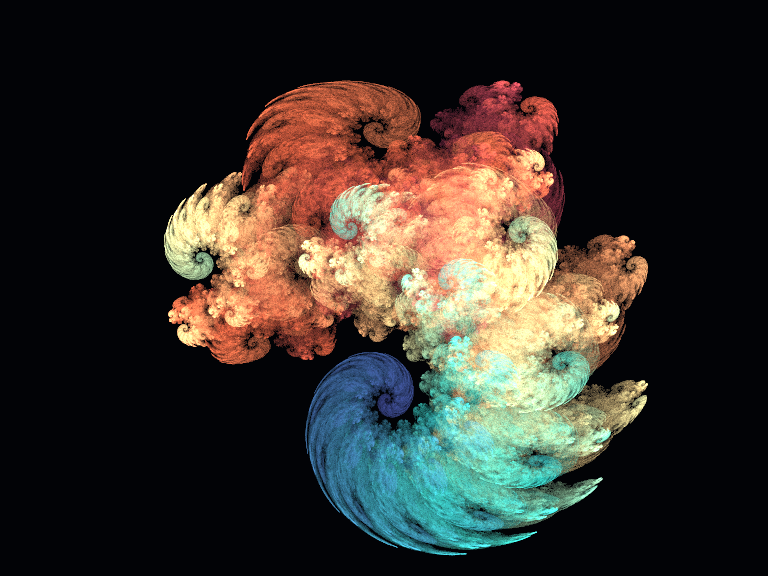

# Apophysis Reborn 0.2.0 — CPU core milestone

A native C++20 command-line renderer for a tested subset of 2D flame files. The distribution contains a Windows x64 executable, a reproducible engine test suite and source history from the foundation checkpoint.



## Run the Windows build

Extract the entire ZIP, open Git Bash in the extracted `apophysis-reborn` folder and run:

```bash
bash scripts/verify-windows.sh
```

This runs the reference, XML and rendering checks, renders Ember Spiral with one and four workers, compares the results, saves a timestamped text log under `logs/`, and opens Explorer with the BMP selected. It requires Git Bash and Windows x64. The prebuilt CLI does not require a development toolchain. Use `--no-open` to suppress Explorer.

Render a different file from the supported subset with:

```bash
./bin/windows-x64/flame-cpu.exe --flame examples/ember-spiral.flame --output ember.bmp
./bin/windows-x64/flame-cpu.exe --list-variations
```

For a gallery of all 15 supported variations, open `examples/variation-studies.flame` and select a study from 1 through 15 using `--index`.

The CLI accepts `--index` (1-based), `--seed`, `--samples`, `--threads`, and `--memory-mib`. The flame provides the dimensions and camera. For the original foundation command syntax use `flame-cpu width height samples output.ppm`. Both BMP and PPM store RGB8. Use a fresh output name to keep both renders. A successful write replaces an existing output of the same name.

## Build from source

CMake 3.20+, a C++20 compiler with threading support, and Expat development files are required. On Windows, the supported distribution in this checkpoint is the cross-compiled executable. A native MSVC build can be attempted from Git Bash with the Visual Studio C++ workload and an Expat installation, for example the vcpkg `expat:x64-windows` port and `VCPKG_ROOT` set. Run:

```bash
bash scripts/build.sh
```

The script configures a release build, builds every executable and runs CTest. See [Windows build](docs/WINDOWS_BUILD.md) for the exact toolchain and static Expat configuration used to produce the shipped binaries.

## Included records

| File | What it covers |
| --- | --- |
| [Engine](docs/RENDERING_ENGINE.md) | How inputs become pixels, accepted numeric settings, rendering differences |
| [Architecture](docs/ARCHITECTURE.md) | Model, parser, sampling, image output and extension points |
| [Compatibility](docs/COMPATIBILITY.md) | Exact XML subset, omitted-field behavior, serializer limits, historical files |
| [Reference tests](docs/REFERENCES.md) | Upstream C function comparisons, independently rendered image, regeneration |
| [Test report and plan](docs/TEST_PLAN.md) | Executed checks, local timings and pending platform acceptance |
| [Feature matrix](docs/FEATURE_MATRIX.md) | Current milestone and outstanding work |
| [Development log](docs/DEVELOPMENT_LOG.md) | Changes since the foundation and next milestone handoff |
| [Third-party notices](docs/LICENSES.md) | Dependency and reference provenance |

The ZIP also includes `apophysis-reborn.bundle` and `BUILD.txt`. For a checkout with the two checkpoint commits, run `git clone apophysis-reborn.bundle ../apophysis-reborn-git` from the extracted folder. The checkout holds source, example flames, tests and documentation. The precompiled Windows executables are distribution outputs. No remote repository is required.

The Windows desktop shell and settings from Milestone 1 remain open. The next compatibility milestone covers authentic Apophysis files, import/export preservation and image comparisons across producer versions. Current tests cover a specific FLAM3 reference and the supported static XML subset.
