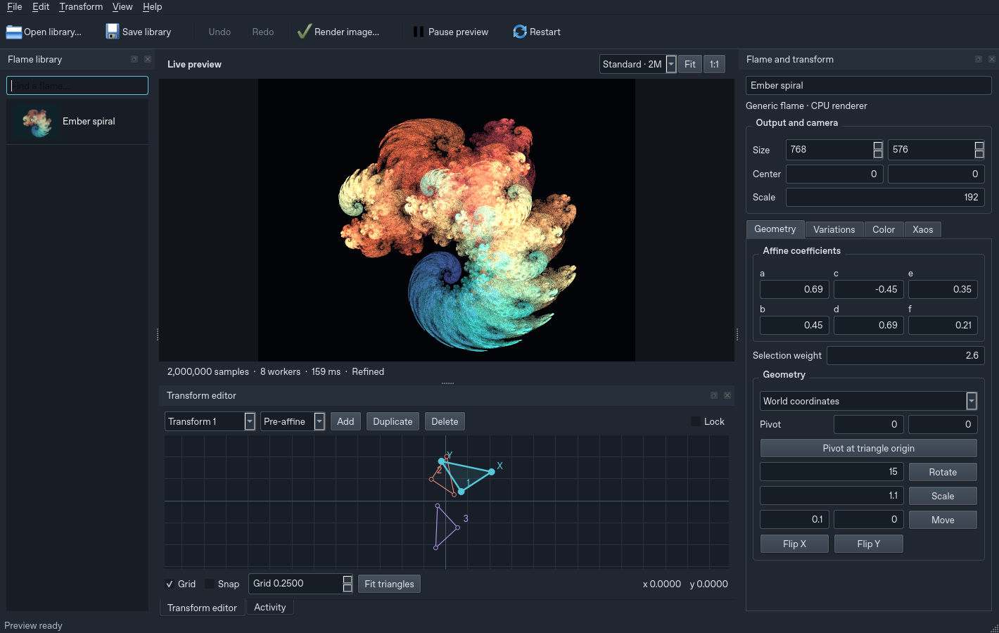

# Apophysis Reborn 0.4.0 — Primary Editor

This checkpoint adds a native Qt desktop editor around the existing CPU flame engine and legacy document model. The window includes a searchable flame library, a refining live preview, interactive transform triangles, exact numeric controls, undo/redo, background image rendering, and recovery copies.

## Open the editor

Extract the complete ZIP and open `bin/windows-x64/apophysis-reborn.exe`. Keep the accompanying DLLs and `platforms` folder beside it. The program starts with Ember Spiral and works offline. Use **Open library** to load a `.flame`, `.xml`, or historical `.temp` collection.

Select a transform in the lower canvas, then drag its origin or its X/Y handles. The **Pre-affine / Post-affine** selector and the coefficient fields edit the same matrix. The right-hand tabs expose geometry, all 21 supported variation weights, JuliaN parameters, color controls, and Xaos. **Save library** retains the original collection and unrelated XML. The [editor guide](docs/EDITOR.md) covers the controls and recovery behavior.



The screenshot was captured from the running Linux Qt build. The portable Windows x64 application and its tests compiled successfully. Windows 11 execution remains pending.

## Verify the Windows package

When ready, open Git Bash in the extracted `apophysis-reborn` directory and run the desktop verification.

```bash
bash scripts/verify-editor-windows.sh
```

It runs the core and Qt tests, launches the editor, renders the example, saves a screenshot and a flame copy, and records a log. Add `--no-open` to suppress Explorer. The [test report](docs/TEST_PLAN.md) distinguishes executed checks from pending platform acceptance.

## Command-line legacy files

Run these examples from Git Bash in the extracted project folder. All paths can contain spaces.

```bash
./bin/windows-x64/flame-cpu.exe inspect tests/legacy/fox-3d-hack.flame
./bin/windows-x64/flame-cpu.exe save tests/legacy/fox-3d-hack.flame --output my-copy.flame --name "My study"
./bin/windows-x64/flame-cpu.exe inspect my-copy.flame --json
```

| Command | Result |
| --- | --- |
| `inspect INPUT [--json]` | Lists entries, original names, declared producers, source lines, CPU renderability and the first render blocker for each entry |
| `save INPUT --output COPY [--index N]` | Writes the entire original document. Optional `--name TEXT`, `--size W H`, `--center X Y` and `--scale S` edit one entry. Indexing starts at 1 |
| `export INPUT --output SINGLE --index N` | Writes a canonical, standalone XML representation of one supported render model. This operation omits wrapper data, history, comments and editor-only metadata. Use `save` to retain the original document |
| `--flame INPUT --index N --output IMAGE.bmp` | Renders the selected entry. Unsupported features in other entries do not block it |

A `preserve-only` entry can still be renamed and saved. Make a copy before editing an original you wish to keep. Providing the input path as the save destination requests an in-place replacement. Failed validation leaves an existing destination intact. The CLI stages file writes next to the destination and replaces the output after a successful close.

## Command-line rendering

Render a different file from the supported subset with:

```bash
./bin/windows-x64/flame-cpu.exe --flame examples/ember-spiral.flame --output ember.bmp
./bin/windows-x64/flame-cpu.exe --list-variations
```

The 21 studies in `examples/variation-studies.flame` cover every registered variation. Use `inspect` to list their names, then select a study by its one-based `--index`.

The CLI accepts `--index` (1-based), `--seed`, `--samples`, `--threads`, and `--memory-mib`. The flame provides the dimensions and camera. For the original foundation command syntax use `flame-cpu width height samples output.ppm`. Both BMP and PPM store RGB8. Use a fresh output name to keep both renders. A successful write replaces an existing output of the same name.

## Build from source

CMake 3.20+, a C++20 compiler, Qt 6.5+ Widgets/Test development files, and Expat development files are required. The packaged GUI uses Qt 6.8.2. Supply the installed Qt kit prefix when needed.

```bash
export APO_QT_PREFIX=/path/to/Qt/6.8.2/your-kit
bash scripts/build-editor.sh
```

A core-only build can use `bash scripts/build.sh -DAPO_BUILD_EDITOR=OFF`. The [Qt build guide](docs/QT_BUILD.md) records the exact Windows toolchain, dependencies, runtime staging, and corresponding source archives included in the ZIP.

## Included records

| File | What it covers |
| --- | --- |
| [Editor](docs/EDITOR.md) | Native library, preview, geometry, saving and recovery controls |
| [Qt build](docs/QT_BUILD.md) | Desktop build, runtime deployment and Windows checks |
| [Engine](docs/RENDERING_ENGINE.md) | How inputs become pixels, accepted numeric settings, rendering differences |
| [Architecture](docs/ARCHITECTURE.md) | Model, parser, sampling, image output and extension points |
| [Compatibility](docs/COMPATIBILITY.md) | Exact XML subset, omitted-field behavior, serializer limits, historical files |
| [Historical corpus](docs/LEGACY_CORPUS.md) | Original producer files, exact round trips and reference-image evidence |
| [Producer pixel tests](docs/PRODUCER_ORACLE.md) | Direct comparisons with historical Pascal image reconstruction |
| [Reference tests](docs/REFERENCES.md) | Upstream C function comparisons, independently rendered image, regeneration |
| [Test report and plan](docs/TEST_PLAN.md) | Executed checks, local timings and pending platform acceptance |
| [Feature matrix](docs/FEATURE_MATRIX.md) | Current milestone and outstanding work |
| [Development log](docs/DEVELOPMENT_LOG.md) | Changes since the foundation and next milestone handoff |
| [Third-party notices](docs/LICENSES.md) | Dependency and reference provenance |

The ZIP also includes `apophysis-reborn.bundle` and `BUILD.txt`. For a checkout with the complete checkpoint history, run `git clone apophysis-reborn.bundle ../apophysis-reborn-git` from the extracted folder. The checkout holds source, example flames, tests and documentation. The precompiled Windows executables and their runtime DLLs are distribution outputs. Corresponding third-party sources accompany the distribution. No remote repository is required.

Milestone 5 adds the full creative tools, including gradient and adjustment editors, mutation, random generation, and further variation coverage. Advanced editor work still includes multi-selection, persistent per-transform locks, synchronization tools, custom shortcuts and broader workspace presets. Windows 11 testing remains deferred.
