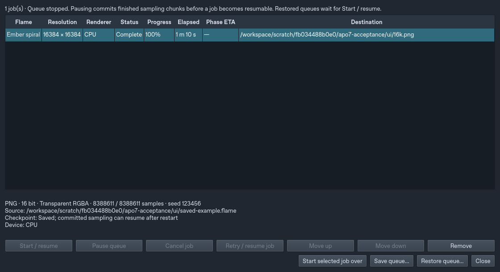

# Apophysis Reborn 0.7.0 — High-Resolution Rendering

This checkpoint adds memory-aware file rendering through **16,384 × 16,384**, a persistent native render queue, durable checkpoints with pause/resume, and true 16-bit PNG/TIFF/PPM export. CPU and Vulkan sample the complete flame in bounded batches; disk-backed hit records feed reconstruction strips with the correct global filter overlap. Output is published only after the complete image has been written successfully.

The native Render image dialog now offers resolution presets, custom dimensions and aspect locking, density or exact samples, filtering/oversampling, RAM/disk/GPU budgets, bit depth and transparent PNG/TIFF. Queued jobs keep immutable flame snapshots. They can be paused, resumed, cancelled, reordered, retried and saved for another session. Restored queues wait for an explicit start.



This screenshot comes from the actual Qt queue acceptance run using the offscreen platform. It completed a full 16K RGBA16 PNG, paused and resumed durable sampling, and kept processing UI events. A separate actual Linux desktop check added and completed a 512 × 512 transparent PNG16 job through the visible controls. Windows binaries compiled and passed dependency auditing; Windows execution and physical-GPU acceptance remain pending. [Detailed verification](docs/HIGH_RES_ACCEPTANCE.md)

The source-preserving editor, all 31 variations, creative tools, CPU reference and Vulkan backend from earlier milestones remain available. Normal builds use the bundled Vulkan headers and compiled shader and do not require a Vulkan SDK.

## Render a large image

Open **File → Render image** (`Ctrl+R`). Select a preset or enter dimensions, choose PNG or TIFF and **16 bit**, and optionally enable **Transparent background (straight alpha)**. The dialog displays the planned working buffers, disk allowance and strip count before adding a job. Choose a destination, then use **Add and start queue** or **Add to queue**.

**Queue** on the toolbar opens the job list. **Pause queue** retains committed sampling; **Start / resume** continues it. The job list records progress, measured phase ETA, actual backend/device and errors. Editing the flame afterward does not change a queued snapshot. Closing the editor requests a safe pause. Keep a job's checkpoint directory if you want to resume later: saving a queue JSON references that directory rather than copying its sampled data.

| Output | Channel depth | Transparency |
| --- | --- | --- |
| PNG / TIFF | 8 or 16 bits | RGB or straight RGBA |
| PPM | 8 or 16 bits | RGB |
| BMP | 8 bits | RGB |

Sixteen-bit values come directly from reconstruction, without expansion from RGB8. The formats are tone-mapped integer images; JPEG, OpenEXR, ICC color management and dithering remain open output work. The [high-resolution guide](docs/HIGH_RES_RENDERING.md), [queue guide](docs/RENDER_QUEUE.md) and [format contract](docs/IMAGE_FORMATS.md) explain budgets, alpha, restart identity and storage behavior.

## Open the editor

Extract the complete ZIP and open `bin/windows-x64/apophysis-reborn.exe`. Keep the accompanying DLLs and `platforms` folder beside it. The program starts with Ember Spiral and works offline. Use **Open library** to load a `.flame`, `.xml`, or historical `.temp` collection.

Select a transform in the lower canvas, then drag its origin or its X/Y handles. The **Pre-affine / Post-affine** selector and the coefficient fields edit the same matrix. The right-hand tabs expose geometry, all 31 supported variation weights, JuliaN parameters, color controls, and Xaos. **Save library** retains the original collection and unrelated XML. The [editor guide](docs/EDITOR.md) covers the controls and recovery behavior.

## Choose the rendering device

Open **Edit → Preferences** to select **CPU (reference)**, **Automatic**, or **Vulkan (FP32 sampling)**. The same controls appear in **Render image**. A new settings profile defaults to Automatic with CPU fallback enabled; the CLI defaults to CPU. Creative previews inherit the chosen backend, device and budgets.

| Setting | Behavior |
| --- | --- |
| CPU | Retains the existing double-precision renderer and its original random stream |
| Automatic | Uses an explicitly preferred device, or chooses usable hardware Vulkan when device selection is automatic |
| Vulkan | Requests Vulkan compute explicitly; software implementations are identified in discovery and output |
| GPU working budget | Limits Vulkan allocations alongside the separate host budget and device storage-buffer limits |
| CPU fallback | Reports the reason and actual CPU backend when Vulkan cannot render; disabling it makes the Vulkan failure explicit |

The Vulkan kernel uses **32-bit orbit calculations**, exact **64-bit integer histogram totals**, and CPU image reconstruction. CPU reference calculations use 64-bit floating point. Different streams, rounding and chaotic amplification mean matching seeds do not guarantee identical pixels across backends or devices. The preview, Activity panel and CLI report what actually ran.

Read the [GPU rendering guide](docs/GPU_RENDERING.md) for controls and commands, [kernel description](docs/GPU_KERNEL.md) for precision and model admission, [CPU/GPU test methods](docs/GPU_TESTING.md) for the comparisons, and [Windows GPU guide](docs/WINDOWS_GPU.md) for later hardware acceptance.

## Creative tools

Use **Flame → Gradient editor**, **Adjustment editor**, **Mutation explorer**, or **Random flame generator**. The toolbar provides the same tools. Each editor previews a working copy; Apply commits one undo step, while Cancel retains the loaded flame. Random batches and kept mutation branches become ordinary collection entries.

| Tool | Available controls |
| --- | --- |
| Gradient | Individual RGB/HSV colors, indexed stops, RGB/HSV interpolation, presets, GPL exchange and local palette library, rotation/reversal/smoothing, seeded random palettes, hue/saturation/value, RGB gamma curves and contrast |
| Adjustment | Dimensions and aspect ratio, camera center/scale/zoom/rotation, orbit framing, background, gamma/threshold/brightness/vibrancy, sample density, oversampling and the supported Gaussian filter |
| Random generation | 1–24 candidates, a 64-bit seed, variation allowlist, transform counts, contraction and translation limits, explicit rotation/reflection symmetry and palette choice |
| Mutation | Candidate grid, strength/trend, independent geometry/variation/color/parameter/palette controls, parent comparison, branching history and selected/batch/branch saving |

Read the [creative tools guide](docs/CREATIVE_TOOLS.md) for exact controls, save behavior and limits.

## Verify the Windows package

When ready, open Git Bash in the extracted `apophysis-reborn` directory and run the desktop verification.

```bash
bash scripts/verify-editor-windows.sh
```

It runs the CPU/core and Qt tests, records device discovery and fallback, exercises the creative dialogs and render queue using CPU rendering, and saves screenshots, image exports, example flames and a GPL palette with a log. Add `--large-render` for the separate full 16K queue acceptance and `--no-open` to suppress Explorer. A GPU is not required.

The separate strict GPU check can be run later when a suitable Windows GPU and driver are available:

```bash
bash scripts/verify-gpu-windows.sh
```

It selects a usable physical device by default and requires actual Vulkan execution with no fallback. `--device ID` selects a device from your discovery report; explicitly selected software devices are labeled as such. The [test report](docs/TEST_PLAN.md) distinguishes the executed Linux checks from pending Windows and physical GPU acceptance.

## Command-line legacy files

Run these examples from Git Bash in the extracted project folder. All paths can contain spaces.

```bash
./bin/windows-x64/flame-cpu.exe inspect tests/legacy/fox-3d-hack.flame
./bin/windows-x64/flame-cpu.exe save tests/legacy/fox-3d-hack.flame --output my-copy.flame --name "My study"
./bin/windows-x64/flame-cpu.exe inspect my-copy.flame --json
```

| Command | Result |
| --- | --- |
| `inspect INPUT [--json]` | Lists entries, original names, declared producers, source lines, CPU renderability and the first render blocker for each entry |
| `save INPUT --output COPY [--index N]` | Writes the entire original document. Optional `--name TEXT`, `--size W H`, `--center X Y` and `--scale S` edit one entry. Indexing starts at 1 |
| `export INPUT --output SINGLE --index N` | Writes a canonical, standalone XML representation of one supported render model. This operation omits wrapper data, history, comments and editor-only metadata. Use `save` to retain the original document |
| `--flame INPUT --index N --output IMAGE.bmp` | Renders the selected entry. Unsupported features in other entries do not block it |

A `preserve-only` entry can still be renamed and saved. Make a copy before editing an original you wish to keep. Providing the input path as the save destination requests an in-place replacement. Failed validation leaves an existing destination intact. The CLI stages file writes next to the destination and replaces the output after a successful close.

## Command-line rendering

Render a different file from the supported subset with:

```bash
./bin/windows-x64/flame-cpu.exe --flame examples/ember-spiral.flame --output ember.bmp
./bin/windows-x64/flame-cpu.exe --list-variations
./bin/windows-x64/flame-cpu.exe --list-devices
./bin/windows-x64/flame-cpu.exe --list-devices --json
./bin/windows-x64/flame-cpu.exe --flame examples/ember-spiral.flame \
  --output ember-vulkan.bmp --backend vulkan --device 0 --no-fallback
```

Replace device `0` with a zero-based index or ID from your own device inventory. The final command requires Vulkan; it cannot silently succeed through CPU fallback. `--backend auto` allows reported CPU fallback by default. Completion output includes the actual backend, device and stage timings.

The 31 studies in `examples/variation-studies.flame` cover every registered variation. Use `inspect` to list their names, then select a study by its one-based `--index`. `examples/seeded-random.flame` contains a nine-candidate generated batch; `examples/creative-branches.flame` contains an original, parent and child saved through the native editor. `examples/gpu-palette-study.flame` was edited and saved during the native Vulkan desktop check.

The CLI accepts the earlier seed, samples, threads and backend options plus `--size W H`, `--oversample`, `--filter-radius`, `--bit-depth`, `--alpha`, `--disk-mib`, `--strip-rows`, `--checkpoint`, `--resume` and `--estimate`. The foundation syntax `flame-cpu width height samples output.ppm` remains available.

```bash
./bin/windows-x64/flame-cpu.exe --flame examples/ember-spiral.flame \
  --output ember-4k.png --size 4096 3072 --samples 20000000 \
  --bit-depth 16 --memory-mib 256 --disk-mib 2048 \
  --checkpoint ember-render-work
```

Append `--estimate` to inspect the plan without creating files. For a controlled pause, append `--pause-after 1000000`; successful pause returns 75. Resume with the same settings and `--resume`, omitting `--pause-after`. Ctrl+C also preserves committed work when an explicit checkpoint was chosen. The [CLI guide](docs/HIGH_RES_RENDERING.md) covers all options and exit statuses. A successful export replaces an existing destination only after encoding completes.

## Build from source

CMake 3.20+, a C++20 compiler, Qt 6.5+ Widgets/Test development files, and Expat and zlib development files are required. The packaged GUI uses Qt 6.8.2. Supply the installed Qt kit prefix when needed.

```bash
export APO_QT_PREFIX=/path/to/Qt/6.8.2/your-kit
bash scripts/build-editor.sh
```

A core-only build can use `bash scripts/build.sh -DAPO_BUILD_EDITOR=OFF`. To disable the Vulkan runtime entirely, add `-DAPO_ENABLE_VULKAN=OFF`. Ordinary builds use the bundled headers and embedded SPIR-V; shader regeneration is documented in the [Qt build guide](docs/QT_BUILD.md), alongside the exact Windows toolchain, runtime staging and corresponding dependency sources.

## Verification in this checkpoint

The final native Release and ASan/UBSan builds each passed **25/25 CTest entries**. A separate Vulkan-disabled core build passed 16 checks and explicitly skipped its three device-execution entries. Existing CPU images, historical producer checks and all 1,560 transform probes remain covered. New tests compare dense and streamed pixels, corrupt and interrupted checkpoints, queue lifecycle, budget rejection and all supported image encodings.

An actual 16K RGBA16 render used 8,388,611 samples and peaked at **39.2 MiB process RSS** with a 128 MiB working-buffer budget. Two independent decoders agreed on every one of its 2,147,483,648 decoded channel bytes. A matching-camera comparison produced identical complete files using 63-row and 247-row strips, including queue pause/resume. The queue's whole Qt process peaked at 182.8 MiB; the 128 MiB setting limits rendering buffers, not all Qt/library/process memory. The [16K acceptance report](docs/HIGH_RES_ACCEPTANCE.md) distinguishes these measurements and documents the sparse sample density of the acceptance image.

## Included records

| File | What it covers |
| --- | --- |
| [High-resolution rendering](docs/HIGH_RES_RENDERING.md) | CLI options, memory/disk planning, checkpoints and resume |
| [Render queue](docs/RENDER_QUEUE.md) | Native job settings, immutable snapshots, persistence and lifecycle |
| [Image formats](docs/IMAGE_FORMATS.md) | PNG/TIFF/PPM/BMP precision, encoding, color and alpha contracts |
| [16K acceptance](docs/HIGH_RES_ACCEPTANCE.md) | Full-image decoding, exact strip comparison, restart and UI measurements |
| [Vulkan hit streaming](docs/GPU_STREAMING.md) | Bounded compute batches and device checkpoint identity |
| [Editor](docs/EDITOR.md) | Native library, preview, geometry, saving and recovery controls |
| [GPU rendering](docs/GPU_RENDERING.md) | Device selection, precision, budgets, fallback and CLI/native smoke commands |
| [Compute kernel](docs/GPU_KERNEL.md) | GPU stages, portable streams, integer accumulation and admission limits |
| [CPU/GPU verification](docs/GPU_TESTING.md) | Numerical/image comparison fixtures, thresholds and execution evidence |
| [Windows GPU verification](docs/WINDOWS_GPU.md) | Optional strict physical-device tests and diagnostic output |
| [Creative tools](docs/CREATIVE_TOOLS.md) | Gradient, adjustment, random generation and mutation workflows |
| [Creative algorithms](docs/CREATIVE_ALGORITHMS.md) | Deterministic generation, palette operations and framing definitions |
| [Variations](docs/VARIATIONS.md) | Complete supported registry, producer conventions and original-source vector evidence |
| [Qt build](docs/QT_BUILD.md) | Desktop build, runtime deployment and Windows checks |
| [Engine](docs/RENDERING_ENGINE.md) | How inputs become pixels, accepted numeric settings, rendering differences |
| [Architecture](docs/ARCHITECTURE.md) | Model, parser, sampling, image output and extension points |
| [Compatibility](docs/COMPATIBILITY.md) | Exact XML subset, omitted-field behavior, serializer limits, historical files |
| [Historical corpus](docs/LEGACY_CORPUS.md) | Original producer files, exact round trips and reference-image evidence |
| [Producer pixel tests](docs/PRODUCER_ORACLE.md) | Direct comparisons with historical Pascal image reconstruction |
| [Reference tests](docs/REFERENCES.md) | Upstream C function comparisons, independently rendered image, regeneration |
| [Test report and plan](docs/TEST_PLAN.md) | Executed checks, local timings and pending platform acceptance |
| [Feature matrix](docs/FEATURE_MATRIX.md) | Current milestone and outstanding work |
| [Development log](docs/DEVELOPMENT_LOG.md) | Changes since the foundation and next milestone handoff |
| [Third-party notices](docs/LICENSES.md) | Dependency and reference provenance |

The ZIP also includes `apophysis-reborn.bundle` and `BUILD.txt`. For a checkout with the complete checkpoint history, run `git clone apophysis-reborn.bundle ../apophysis-reborn-git` from the extracted folder. The checkout holds source, example flames, tests and documentation. The precompiled Windows executables and their runtime DLLs are distribution outputs. Corresponding third-party sources accompany the distribution. No remote repository is required.

**Next: Milestone 8 — extended compatibility**, including scripting, plugins and additional historical formats. Physical NVIDIA/AMD/Intel execution, Windows 11 behavior and hardware performance measurement remain separate acceptance work. CUDA is optional and not implemented. Advanced editor and creative compatibility gaps remain listed in [FEATURE_MATRIX.md](docs/FEATURE_MATRIX.md), including additional variations, historical reconstruction curves, density estimation, palette catalogs and broader workspace controls.
