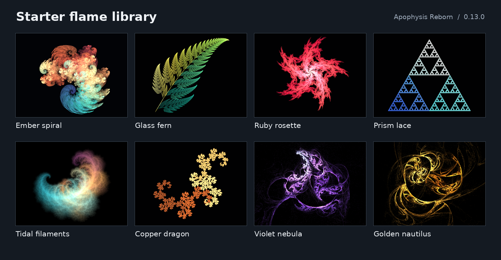

# Apophysis Reborn

**Apophysis Reborn is an unofficial, AI-generated clone of the original Apophysis fractal flame editor.** The original Apophysis was created by Mark Townsend and contributors. Reborn recreates its editing and rendering workflow in C++20 and Qt 6 for modern CPUs and Vulkan-capable GPUs. AI generated the Reborn application code and documentation. The repository owner directed and published the project. They did not personally write the application code. The original creators and third-party contributors retain credit for their own work.

## 0.16.0 testing build

Choose **Render image… → Proof a crop…** to inspect a region at final resolution and adjust its tone using the same samples. Select **Include editable flame in PNG** to make an image that opens as an editable project. [Walkthrough](docs/USER_MANUAL.md#proof-and-editable-png) · [0.16.0 release notes](docs/RELEASE_0.16.0.md)

## 0.15.0 personal favorites and variation explorer

Save an editable flame with tags from the **Flame library** dock. Reopen **Favorites…** from another project to add a copy. Under **Flame → Variation explorer…**, pick a built-in variation and compare several values on your selected transform. Applying a result creates one undo step. [User manual](docs/USER_MANUAL.md#favorites-and-variation-explorer) · [Release notes](docs/RELEASE_0.15.0.md) · [Build roadmap](docs/ROADMAP.md)

## Local AI connection

An MCP-compatible assistant on the same computer can inspect the editor’s selected flame, see its live preview and propose Lua edits. Use **Tools → Local AI connection…** to copy the client configuration and enable sharing for the current session. Run a proposal on a copy, preview its results, then apply or discard it. The Windows companion is included in both Windows editions. [Connect an assistant and try three variations](docs/LOCAL_AI.md)

## Published Windows x64 downloads · 0.15.0

| Download | How to use it |
| --- | --- |
| [Windows installer](https://github.com/mesothelioma-commits/apophysis-reborn/releases/download/v0.15.0/apophysis-reborn-0.15.0-windows-x64-setup.exe) | Close the editor and run Setup. It installs for the current Windows user. The installer is unsigned. |
| [Portable ZIP](https://github.com/mesothelioma-commits/apophysis-reborn/releases/download/v0.15.0/apophysis-reborn-0.15.0-windows-x64-portable.zip) | Use **Extract All** in File Explorer, then open **apophysis-reborn.exe** inside the extracted folder. Keep the companion executable and DLLs beside it. |
| [Source and Git history](https://github.com/mesothelioma-commits/apophysis-reborn/releases/download/v0.15.0/apophysis-reborn-0.15.0-git-source.zip) | Includes the source used to build the Windows packages and a restorable Git history. |
| [Offline guides, examples and plug-in SDK](https://github.com/mesothelioma-commits/apophysis-reborn/releases/download/v0.15.0/Apophysis-Reborn-0.15.0-Guides.zip) | Extract the ZIP. Use the manual to learn the editor, or follow a walkthrough below. |
| [SHA-256 checksums](https://github.com/mesothelioma-commits/apophysis-reborn/releases/download/v0.15.0/SHA256SUMS.txt) | Compare a download with its published hash using PowerShell: `Get-FileHash -Algorithm SHA256 'path-to-file'`. |

Both Windows editions can render offline. CPU rendering works without a Vulkan driver. GPU sampling requires a driver that exposes Vulkan. Setup installs the new payload before attempting to remove the most recent older registered version. Save artwork in a folder of your own. [All release assets](https://github.com/mesothelioma-commits/apophysis-reborn/releases/tag/v0.15.0)

## Plug-ins, scripts and local AI

| What you want to do | Walkthrough |
| --- | --- |
| Install a variation or build your own | Enable the bundled wave, render its sample, then change the C example and package a Windows x64 variation. [Plug-in guide](docs/PLUGINS.md) |
| Write and run a script | Make a copper-colored copy of a flame in Lua, preview it, then apply it in the editor or run the script from PowerShell. [Scripting guide](docs/SCRIPTING.md) · [Supported legacy scripts](docs/LEGACY_SCRIPTING.md) |
| Connect an AI assistant | Configure a local MCP client, inspect the selected flame and review a proposed edit. [AI setup and troubleshooting](docs/LOCAL_AI.md) |

## Make a first image

1. Launch the application and select **Ember spiral** in the Flame library. The center pane shows its live preview.
2. Choose **File → Save as…** and save a working copy as `First flame.apoproject`.
3. Open **Gradient**, select **Glacier**, click **Use preset**, then **Apply gradient**. Press **Ctrl+S** to keep the edit.
4. Open **File → Render image…**. For this starter, try **768 × 576** and **PNG · 8 bit**. Browse for an output filename and click **Add and start queue**.
5. When the queue shows **Complete**, open the PNG in File Explorer. Reopen the project when you want to adjust the drawing rules or colors.

Press **F1** in the editor for offline documentation. [User manual](docs/USER_MANUAL.md) · [Illustrated first-session guide (0.13.0 PDF)](docs/Apophysis-Reborn-0.13.0-User-Guide.pdf)

## Editing and rendering

- Edit eight starter flames with affine transforms, palettes, tone curves, variations, mutation, and a seeded random generator. The renderer implements 43 built-in variations.
- Use multithreaded CPU rendering or Vulkan sampling. Render in strips, queue images, and resume compatible checkpoints. The image size limit is 16,384 pixels per side.
- Save editable native projects, preserve supported parts of legacy flame libraries, and export PNG, TIFF, PPM, or BMP images. Use the timeline for numbered frame sequences or the command-line renderer for batch work.

Legacy compatibility varies by producer and feature. Some documents can be preserved on save while an unsupported operation prevents rendering. Historical 3D and direct-color behavior, some filters, and parts of the original scripting and plugin workflows remain incomplete. See the compatibility report before depending on a specific older flame. [Compatibility and outstanding work](docs/RELEASE_COMPATIBILITY.md)

[Previous 0.14.0 release notes](docs/RELEASE_0.14.0.md) · [0.13.0 release and version-specific Windows test kit](https://github.com/mesothelioma-commits/apophysis-reborn/releases/tag/v0.13.0)

## Build a fork with an AI assistant

Start with the fork guide for a copy-and-paste prompt, Git commands, development dependencies, a baseline build, tests, and instructions for packaging a changed version. [Fork and build guide](docs/AI_FORK_GUIDE.md)

| I want to… | Start here |
| --- | --- |
| Understand the editor and renderer | [Architecture](docs/ARCHITECTURE.md) · [Rendering engine](docs/RENDERING_ENGINE.md) · [Hardware acceleration](docs/GPU_RENDERING.md) |
| Work with legacy files or variations | [File compatibility](docs/COMPATIBILITY.md) · [Variation reference](docs/VARIATIONS.md) |
| Build, test, or package for Windows | [Qt desktop build](docs/QT_BUILD.md) · [Release handoff](docs/RELEASE_HANDOFF.md) · [Packaging](packaging/README.md) |
| Explore previous milestones and engineering notes | [Technical notes](TECHNICAL-NOTES.md) · [Development history](docs/DEVELOPMENT_LOG.md) |

## Credits and licenses

The historical references include the original Apophysis editor, Apophysis 7X, Apophysis AV, and FLAM3 by Scott Draves and contributors. FLAM3 supplies published reference formulas and test material used for numerical and image comparisons. Reborn runs its own C++ renderer. [Original Apophysis](https://sourceforge.net/projects/apophysis/) · [Apophysis 7X](https://github.com/xyrus02/apophysis-7x) · [Apophysis AV](https://sourceforge.net/projects/apophysis-av/) · [FLAM3](https://github.com/scottdraves/flam3)

The repository records licenses and attribution separately for dependencies, historical fixtures, and credited artwork. This release has no project-wide license for the Reborn implementation. Check the applicable terms before redistributing a modified build, and keep the accompanying notices and corresponding dependency sources with packaged releases. [Dependency and reference notices](docs/LICENSES.md) · [Historical asset attribution](tests/legacy/ATTRIBUTION.md) · [License texts](licenses/)
